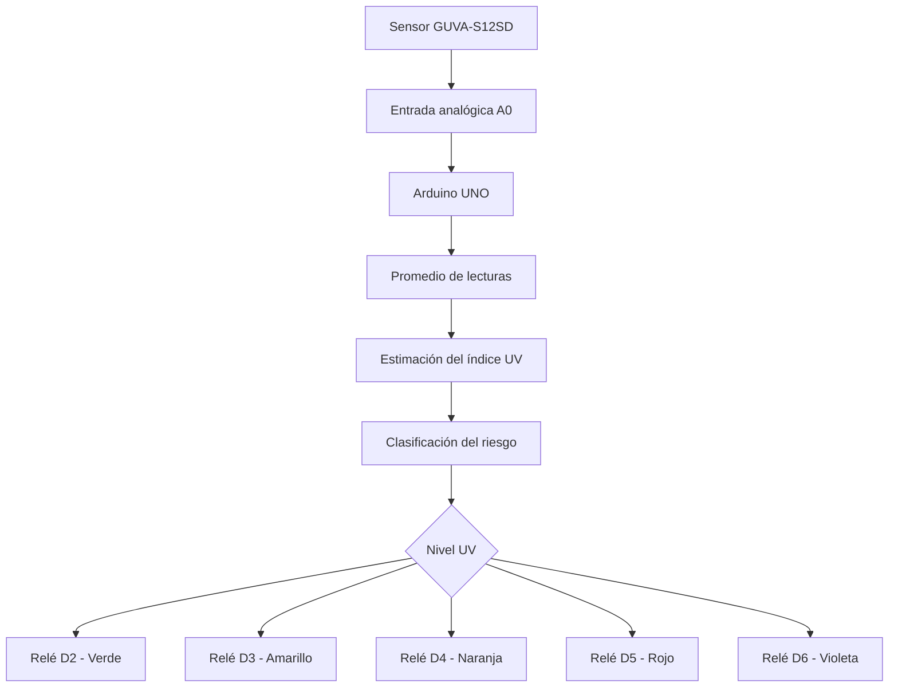

# Solmáforo – Sistema de medición de radiación UV

Sistema electrónico para medir la radiación ultravioleta (UV) mediante un sensor **GUVA-S12SD** y representar el nivel de riesgo a través de cinco indicadores luminosos controlados por Arduino UNO.

El proyecto busca desarrollar una herramienta educativa y de concientización sobre los efectos de la radiación ultravioleta en la salud, facilitando la interpretación del índice UV mediante un sistema visual similar a un semáforo.

## Versión actual: V1 – Autónoma

La primera versión funciona de manera completamente autónoma: no requiere conexión a Internet, Wi-Fi, servidor externo ni computadora para operar.

La medición se realiza mediante el sensor GUVA-S12SD y el procesamiento está a cargo de un Arduino UNO. Según el índice UV estimado, se activa uno de los cinco relés correspondientes a los niveles de riesgo.

##  Objetivos:

- Medir la radiación ultravioleta mediante un sensor electrónico.
- Estimar el índice UV a partir de la señal analógica del sensor.
- Clasificar el nivel de riesgo según los rangos de referencia del índice UV.
- Representar visualmente los niveles mediante cinco indicadores.
- Desarrollar una plataforma didáctica para trabajar conceptos de electrónica, programación y prevención de la exposición solar.

## Componentes utilizados:

| Componente | Función |
|---|---|
| Arduino UNO | Unidad de procesamiento |
| GUVA-S12SD | Sensor de radiación UV |
| Módulo de rele x 5 | Control de los indicadores |
| Indicadores luminosos (lampara 2 W) | Representación del nivel UV |
| Fuente de alimentación | Alimentación del sistema |
| Cables y conexiones | Interconexión electrónica |

## 🔌 Conexiones

### Sensor GUVA-S12SD

| Sensor | Arduino UNO |
|---|---|
| OUT | A0 |
| GND | GND |
| VCC | Según las especificaciones del módulo |

**Importante:** verificá la tensión de alimentación admitida por tu módulo GUVA-S12SD. La salida analógica conectada a A0 nunca debe superar la tensión de referencia del Arduino UNO.

### Módulos rele

| Nivel UV | Pin Arduino |
|---|---|
| Bajo – Verde | D2 |
| Moderado – Amarillo | D3 |
| Alto – Naranja | D4 |
| Muy alto – Rojo | D5 |
| Extremo – Violeta | D6 |

La configuración inicial del programa considera módulos de relés activos en nivel bajo (*Active LOW*). Si tu módulo trabaja con lógica activa en nivel alto, modificá el parámetro correspondiente en el código.

## Clasificación del índice UV

El sistema utiliza cinco categorías de riesgo:

| Índice UV | Nivel de riesgo | Indicador |
|---|---|---|
| 0 a 2 | Bajo | 🟢 Verde |
| 3 a 5 | Moderado | 🟡 Amarillo |
| 6 a 7 | Alto | 🟠 Naranja |
| 8 a 10 | Muy alto | 🔴 Rojo |
| 11 o más | Extremo | 🟣 Violeta |

Los límites de clasificación siguen las categorías habituales del índice UV. El programa incorpora histéresis y un tiempo mínimo de permanencia para evitar cambios constantes de indicador ante pequeñas fluctuaciones de la medición.

## Funcionamiento

El proceso general del sistema es el siguiente:

1. El sensor GUVA-S12SD detecta la radiación ultravioleta.
2. La señal analógica llega al pin A0 del Arduino UNO.
3. El microcontrolador realiza un conjunto de lecturas y calcula un valor promedio.
4. La señal se convierte a tensión y se estima el índice UV mediante los parámetros de calibración.
5. El programa determina la categoría de riesgo.
6. Se activa el relé correspondiente al nivel detectado.

### Diagrama general



## Estructura del repositorio

```text
Solmaforo/
│
├── arduino/
│   └── Solmaforo_GUVA_UNO_V1.ino
│
├── PLANILLA_CALIBRACION.md
│
└── README.md
```

- `Solmaforo_GUVA_UNO_V1.ino`: programa principal para Arduino UNO.
- `PLANILLA_CALIBRACION.md`: guía y registro de mediciones para calibrar el sensor.
- `README.md`: documentación general del proyecto.

## Instalación y puesta en marcha

1. Descargar o clonar este repositorio.
2. Abrir el archivo `Solmaforo_GUVA_UNO_V1.ino` con Arduino IDE.
3. Conectar el Arduino UNO mediante USB.
4. Seleccionar la placa **Arduino UNO** y el puerto correspondiente.
5. Verificar las conexiones del sensor y del módulo de relés.
6. Cargar el programa.
7. Abrir el monitor serie a **9600 baudios** para observar las mediciones.

## Calibración del sensor

La conversión de la señal analógica del GUVA-S12SD a índice UV depende de las características del módulo y de su circuito electrónico.

Por este motivo, los parámetros iniciales incluidos en el programa son valores de referencia para comenzar las pruebas y **no deben considerarse una calibración definitiva**.

Para obtener mediciones confiables se recomienda comparar las lecturas del sistema con un instrumento de medición UV de referencia.

Los parámetros principales de calibración se encuentran en el código:

```cpp
const float ADC_REFERENCE_V = 5.000;
const float VOLTAGE_AT_UVI_ZERO = 0.000;
const float VOLTS_PER_UVI = 0.100;
```

- `ADC_REFERENCE_V`: tensión real de referencia del ADC del Arduino UNO. Conviene medir la alimentación de 5 V con un multímetro.
- `VOLTAGE_AT_UVI_ZERO`: tensión de salida correspondiente al punto de referencia de índice UV cero, según la calibración.
- `VOLTS_PER_UVI`: variación de tensión asociada a una unidad de índice UV, según la calibración realizada.

La guía `PLANILLA_CALIBRACION.md` permite registrar las mediciones y calcular los parámetros necesarios.

## Características del firmware

- Lecturas analógicas del sensor UV.
- Promediado de múltiples muestras.
- Estimación del índice UV.
- Clasificación en cinco niveles de riesgo.
- Histéresis para reducir fluctuaciones.
- Tiempo mínimo de permanencia antes de cambiar de nivel.
- Control individual de cinco relés.
- Salida de datos por monitor serie.

## Próximas versiones V2

El proyecto está pensado para evolucionar progresivamente.

**V1 – Sistema autónomo**
- Arduino UNO.
- Sensor GUVA-S12SD.
- Cinco indicadores controlados mediante relés.
- Funcionamiento sin conexión a Internet.

**V2 – Sistema conectado**
- Incorporación de conectividad Wi-Fi mediante ESP32 o ESP8266.
- Envío de mediciones a una plataforma IoT.
- Visualización del índice UV en un tablero web.
- Registro histórico de mediciones.
- Posibilidad de incorporar notificaciones y alertas.

## Consideraciones importantes

Este proyecto tiene fines educativos y experimentales. Las mediciones obtenidas dependen de la calibración del sensor, las condiciones ambientales, la orientación y la ubicación del dispositivo.

No debe utilizarse como instrumento certificado ni como sustituto de las mediciones oficiales del índice UV para tomar decisiones sanitarias.

Para las primeras pruebas, se recomienda utilizar cargas de baja tensión. Si se emplean relés para conmutar tensión de red, deben respetarse las normas de seguridad eléctrica, aislamiento y protección correspondientes.

## Referencias

- [Organización Mundial de la Salud – Radiación ultravioleta](https://www.who.int/health-topics/ultraviolet-radiation)
- [Arduino – Documentación oficial](https://docs.arduino.cc/)
- [GUVA-S12SD – Sensor de radiación ultravioleta](https://www.google.com/search?q=GUVA-S12SD+datasheet)

---

**Proyecto educativo de electrónica, programación e Internet de las Cosas (IoT). - Cátedra de Electrónica Digital II**
**Profesor: Eduardo Gómez**
**Alumnos: Martinez, Rivera, Rios, Bulacio**
*Solmáforo: medir, interpretar y prevenir.*
